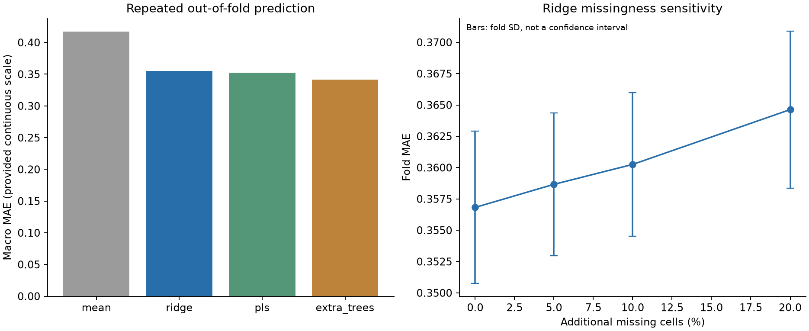
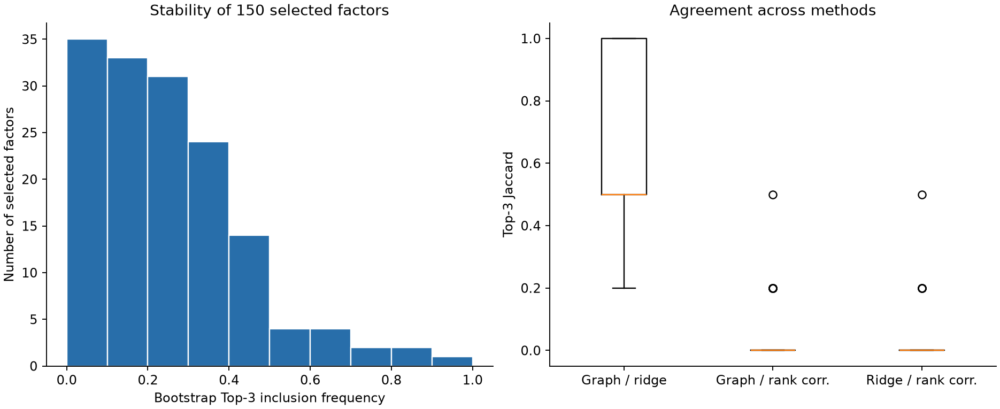
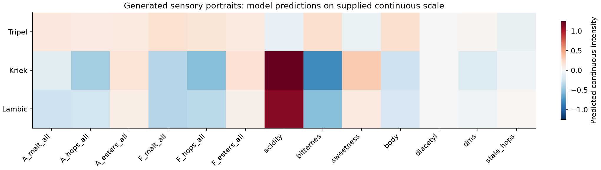
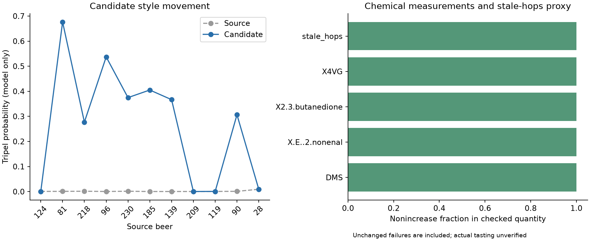

# A 题阶段成果报告

本阶段为 AI 辅助研究基线，三问均有可运行实现和阶段产物。数值只对应当前配置与当前附件。原始 0–6 分标定、真实感官改善及化学因果仍未完成验证，不能将整份报告直接作为最终参赛结论。

## 已核实的数据事实

实际有 250 个样本、231 个化学或理化数值字段、50 个连续感官目标和 22 种风格。以 beer 唯一键一对一关联，不使用受损 beer_id。附件相关矩阵与重算 Spearman 的平均绝对差为 1.58323e-16，与 Pearson 为 0.0873039。逐字段变换证据、模板检查、哈希和字典保存在 audit/。这些是文件证据，关于合理性的解释仍需队内复核。

## 第一问 处理 方法与结果

输入为附件 1 的数值字段，目标为附件 4 的 50 个连续感官字段。样本编号、条码和风格标签均不作为化合物预测特征。训练折内拟合 1%—99% 截尾、缺失中位数与标准化。采用按风格分层的 3 折、2 次重复外层验证，岭回归和 PLS 的超参数在外层训练数据内再做 3 折选择。每个样本的重复留出预测取平均。预先指定岭回归作为下游参考，未根据外层成绩选择冠军再声称独立测试性能。

| 方法 | 宏平均 MAE | 宏平均 RMSE | 宏平均 R² |
|---|---:|---:|---:|
| mean | 0.416927 | 0.568702 | -0.006749 |
| ridge | 0.355414 | 0.494659 | 0.203027 |
| pls | 0.352419 | 0.485663 | 0.220490 |
| extra_trees | 0.341563 | 0.478539 | 0.239697 |

岭回归相对于训练均值参照的宏平均 MAE 变化为 14.75% 的下降。该结果衡量给定连续标签的插值预测，不能当作真实 0–6 分精度，也不证明对全新风格的迁移能力。逐维误差、各风格误差、折分配和附加缺失压力实验均已保存。图中的折间标准差不是置信区间。

`ASSUMPTION_percentile_grades_0_6.csv` 采用训练折目标的七等频经验分位边界，只是有明确假设的参考等级。它不能恢复“未感知”等绝对评分语义，集中于同一值的目标也会出现重复分位边界。绝对标定仍为 UNRESOLVED。最终模型的全数据拟合系数仅供复现与下游画像，不用于报告样本外精度。

## 第二问 处理 方法与结果

按全矩阵秩相关一致性核对附件 1 与 2 的变量别名。网络边保留绝对相关大于等于 0.7 的关系，保存符号与绝对权重。用符号拉普拉斯约束岭回归，求解 (ZᵀZ + αI + λL)B = Zᵀ(Y − 均值)。L 的非对角元素为负的有符号相关权，度数取绝对权和，因而为半正定。固定 α=20.0、λ=5.0；这是探索参数，尚未证明最优。

Top-3 仅从明确的化合物或元素字段中选择，排除 pH、色度、综合总量及混合指标。每个目标给出 3 项，共 150 条，附方向、秩相关、网络模块、来源元数据及人工机理核查字段。100 次样本 bootstrap 中重新拟合预处理和网络，再计算入选频率。与无图岭回归、边际秩相关 Top-3 比较 Jaccard。

当前选定因素中，入选频率低于 0.5 的有 137/150 条，提示单个因素排序存在明显不稳定性。Graph/ridge 的平均 Jaccard 为 0.6800，Graph/Spearman 为 0.0420。这些差异应保留，不宜只展示一致的维度。来源与缺陷描述来自附件元数据，每个目标的具体化学机理论证仍需队员查阅原始文献并复核。全数据关联分析不构成独立预测验证或因果识别。

较高频候选包括 4VG 感官目标与 X4VG、金属味与 iron、烘烤麦芽感官与 methylpyrazine；它们仍只是当前重采样设计下的候选。某些目标排名出现反直觉化合物，说明模型和化学论证需要继续改进，不能把完整 Top-3 表当作已经确定的机理清单。

## 第三问 处理 方法与结果

分层留出 20% 样本作为生成模型诊断参考。训练数据上拟合预处理和 10 维 PCA；各风格采用独立均值，协方差按 n/(n+10) 与全体训练协方差部分汇聚。采样后还原到附件特征尺度并限制在训练 1%—99% 范围，生成每种指定风格 40 组化合物或理化描述符。全数据拟合的第一问参考模型输出感官画像，属于模型推断。

风格分类器在生成模型留出集上的平衡准确率为 0.5644。该分类器与生成模型共享训练资料，并不是外部独立鉴定；其保留样本表现与生成物风格概率仅作模型诊断。Kriek、Lambic 等风格的真实留出样本很少，KS/MMD 指标无法证明完整分布已被可靠学会。KS 仅比较各字段实际非缺失的留出观测，字段数量另列；MMD 使用训练预处理后的表示。详见 generation_diagnostics.csv，并保留真实训练样本重采样的参照 MMD。

跨风格迁移先在潜空间施加风格均值差，再搜索连续插值候选。DMS、双乙酰、4VG 和 trans-2-nonenal 的附件字段逐项不得增加；Stale hops 没有直接化合物观测，以第一问的预测值不增加作为单独代理约束。候选还需使固定分类器的 Tripel 概率相对于原始样本以及仅做截尾的对照均增加超过 0.01，避免把异常清理效果混为风格迁移。未找到满足条件的非零改变候选时，保留原样并标为未找到，不计成功。

当前共有 11 个 Pils/Lager 来源样本，找到非平凡模型内可行候选 7 个；其中生成模型留出来源样本为 2 个，找到候选 2 个。任何缺陷源值缺失、越出训练经验边界或仅能依赖预测代理的情况均在 transfer_diagnostics.csv 标注。所有字段检查保存在 defect_nonincrease_checks.csv。即使这些检查全部通过，也只能说明被检查的测量量或模型代理满足条件，不能声称实际品评无恶化。

## 保留结果与下一阶段

可保留：原件哈希和样本键审计、逐字段尺度证据、既定验证下的误差表、Top-3 与重采样频率、生成样本与诊断、逐项迁移约束核查。它们均绑定 config.json 与运行环境。

需要继续研究：真实评分标定锚点；未确定尺度与异常值的来源；目标相关的化学解释；网络与生成参数敏感性；新的独立验证；聚合指标的物理一致性；完整阈值和真实感官实验。原始研究或其他项目中的已发表成绩不属于本次实测结果。所有采纳的 AI 辅助成果须依赛事要求披露并由队内独立验证。

方法详见 docs/，来源详见 docs/SOURCES.md，运行日志详见 docs/RESEARCH_LOG.md。
