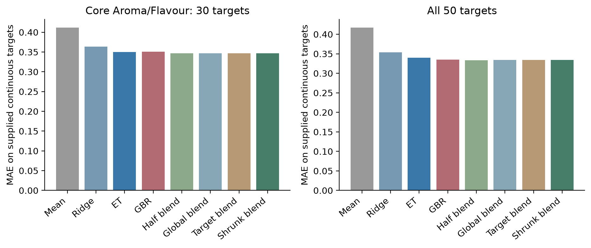
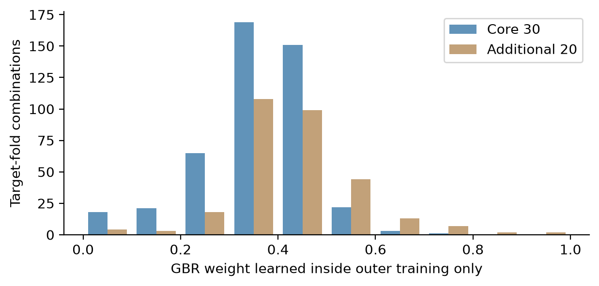
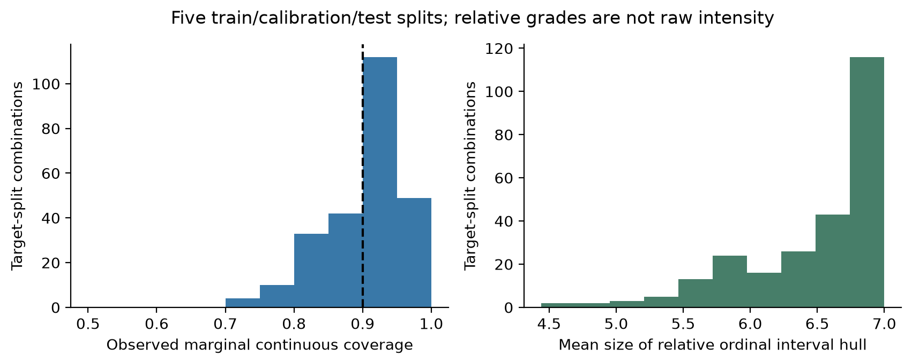
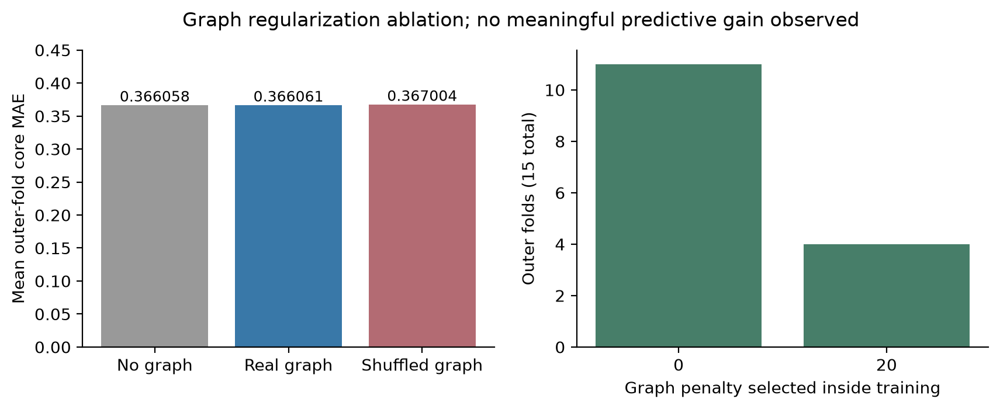
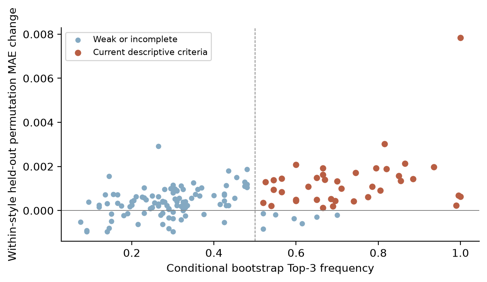
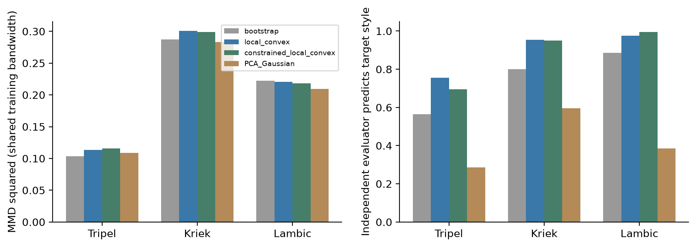
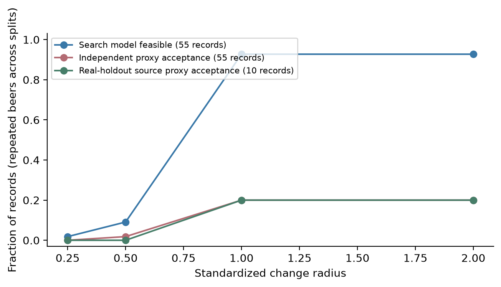

# 尺度核查与独立评价下的啤酒感官预测及约束风格迁移

## 摘要
针对啤酒感官评分、关键因素与风格生成问题，构建尺度审计、分范围预测和独立代理评价流程。以250款酒的231个输入和50个目标建模，明确30个Aroma/Flavour核心维度并保留全表。三折五次重复留出中，ET核心宏平均MAE为0.3496，训练内收缩融合为0.3466；五次独立角色分割的平均逐维连续覆盖为90.06%，但相对等级不等于原始0-6分。加入无图及打乱图对照后，真实图与无图误差几乎相同，全数据内层选择图惩罚为0，不支持额外预测收益。150条因素候选中39条满足当前描述条件，化学证据分级保留。生成阶段去除五个未核实综合量，以100款搜索、100款评价、50款真实留出隔离，比较四类生成方法；非复制优势未转化为全面分布距离优势。半径1下，真实留出源酒的10条重复迁移记录仅2条获独立风格及陈旧酒花代理共同支持。研究提供任务化建模与证据边界，不主张新的基础算法、绝对评分恢复或真实品评改善。

关键词：感官预测；相对分级；嵌套验证；网络消融；条件生成；独立评价

## 1 问题重述与研究目标

本题要求由化合物测量给出感官评分、逐维 Top-3 及稳定性和化学解释，并按风格生成化合物谱和完成缺陷不恶化的迁移。与附件高度吻合的原始研究已用化学资料预测感官并开展加标试验[1]；其数据和已有发现是研究背景，不计作本研究新增贡献。

本文以实际 250 款啤酒、231 个数值输入和 50 个监督目标为基础。保留全部目标输出，另把 A_ 与 F_ 前缀的 30 个核心维度作为预先明确的主要比较范围，其他 20 项按评分卡章节补充报告。这个范围选择不代表官方只要求 30 项，也不把题面“约 40”强行解释为一个与附件不符的固定数量。

三项研究目标分别为：明确连续标签与 0-6 等级的可解释范围；检验网络和候选因素的预测信息是否稳定；把统计可行的风格调整与独立模型支持、真实化学和品评证据区分。无法获得的新测量不以模型输出补造。

## 2 相关工作、贡献边界与模型假设

ExtraTrees[2]、梯度提升回归[3]及利用交叉验证预测学习组合权重的 stacking[4]均为成熟方法。图拉普拉斯约束回归已有系统研究[5]，分割保形预测也已有理论和方法[6]。本文采用这些方法并作任务化组合，不主张首次发明基础算法、收缩融合、Pareto 优化或新的保形理论。

本文的可核查贡献定位于应用建模和证据评估：逐字段尺度及评分位置核查；在明确目标范围内对标准模型及收缩融合公平比较；加入无图和打乱图对照，检验网络的额外价值；分离生成搜索资料与评价资料，并如实报告代理判断分歧和失败。贡献是否成立由具体实验决定，不要求所有复杂设计获胜。

假设一，beer 唯一标识相同酒，跨表正确对应，经集合、唯一性和风格一致性支持。假设二，训练内插补、截尾和标准化提供可检验的统计处理，但不证明极端值错误或缺失随机。假设三，相关网络只提供共变结构，系数不是因果效应。假设四，风格内统计插值与经验支持约束不充分保证酿造可行。假设五，覆盖解释依赖相应交换性与测量条件，不能自动推广到自适应搜索后的分布外样本。

| 符号 | 定义 |
|---|---|
| X、Y | 231 个输入与 50 个连续目标；生成主模型使用 226 个非聚合字段 |
| Z、B、L | 训练预处理后的输入、回归系数及有符号图拉普拉斯 |
| w_j、η | 目标 j 的 GBR 权重及向全局权重收缩的惩罚 |
| g、[L_y,U_y] | 固定训练分位等级映射与连续预测区间 |
| G、J、T | 生成/搜索训练组、独立评价训练组、真实留出组 |
| r、D | 标准化改动半径和四项指定化学缺陷字段集合 |

## 3 数据审计与处理

### 3.1 对齐、字段与评分卡核查

实际 1.csv 为 250×234，含 3 列元信息；4.csv 含 50 个目标。beer_id 在感官文件精度受损，不作为主键。程序按 beer 对齐并核对风格；原件以 SHA-256 绑定版本，未修改附件。2.csv 与重算 Spearman 的平均绝对差约 1.58×10^-16，而与 Pearson 约差 0.0873，因此按秩相关解释。

评分卡 summary 与监督目标的三个显式别名为 A_ester_fruity→A_esters_fruity、F_ester_fruity→F_esters_fruity、4vg→X4vg。50 个目标均已对应。评分卡另有 Aroma、Flavour 乙醛位置而没有对应的独立监督列，保留缺标签说明，未补零。12 处 Barnyard 汇总引用 AG76，表单标签却对应 AG90，列为疑似源公式问题；这不自动证明 4.csv 继承该问题。

| 资料或范围 | 数量/用途 | 处理决定 |
|---|---|---|
| 核心 Aroma / Flavour | 15+15 个前缀目标 | 主比较，全部保留输出 |
| 其他感官目标 | 20 个 | 口感、缺陷、香料、Lambic 与总体等另报 |
| 输入字段 | 231 个 | 预测阶段保持附件尺度 |
| 生成主输入 | 226 个非聚合描述字段 | 五个未核实综合量不独立生成 |
| 3.xlsx 原评分卡 | 12 张 beer 页及 summary | 输入空白和公式缓存零不作为评分真值 |

### 3.2 尺度、缺失和异常处理

逐列比对可比的原始正值配对，有 37 个字段支持 log10 关系；其他字段存在多数恒等、少数不匹配或缺参考。正值匹配不证明零替代值、检测限或全部量纲均已恢复，因此不把全表统一反对数。DMS、4VG 的正值变换证据与双乙酰、trans-2-nonenal 的不匹配另列。

所有预测预处理只在当前训练部分估计：1%/99% 截尾、中位数插补、均值和标准差标准化，使用 Pipeline 管理[7]。验证和测试只执行已拟合变换。去截尾、2.5% 截尾和模拟缺失作为消融，不能把被截值称为错误测量。

公式（1）：z_ij = [clip(x_ij;a_j,b_j)-m_j]/s_j

## 4 第一问：连续预测、相对分级与不确定性

### 4.1 绝对评分的信息缺口与交付定义

原始研究按品评人员中心化和标准化。若逐人均值、标准差、出席情况及汇总权重缺失，同一聚合连续值可能对应多组原始评分，无法唯一反演真实 0-6 分。空白评分卡不能提供锚点。本文不把经验映射包装成真实品评等级。

公式（2）：z_it=(s_it-μ_t)/σ_t，s_it=μ_t+σ_t z_it

实际交付包括全 50 维连续留出预测和带 ASSUMPTION 标记的相对 0-6 等级。相对 0 是训练参考的最低一档，不等于真实未检出；相对 6 也不等于真实压倒性。若题目要求真实绝对等级，仍需原始锚点或转换参数；本文诚实保留这一未解决的测量信息条件。

### 4.2 模型与严格训练内融合

比较均值、岭回归、ET、GBR、固定半数 ET/GBR、全局权重、无收缩逐维权重和收缩逐维权重。ET 200 棵树、最小叶样本 3、特征比例 0.8；GBR 每目标 100 棵深度 2 的树，学习率 0.04、最小叶样本 5、特征比例 0.7。岭回归 α 在 {1,10,100,1000} 中以内层核心 MAE 选择；元信息和风格不作为第一问预测输入。

公式（3）：B_hat=argmin_B ||Yc-ZB||²_F+α||B||²_F

融合权重的具体目标是内层留出预测的均方误差加向全局权重的二次惩罚，最终 η 由训练内验证的核心 MAE 选择。设 d=p_GBR-p_ET、e=y-p_ET，得到受限闭式权重：

公式（4）：w_j=clip{[mean_i(d_ij e_ij)+ηw_0]/[mean_i(d_ij²)+η],0,1}

η∈{0,0.01,0.1,1,10}。对每个外层训练集，再分 S/V；只在 S 内三折产生基础预测并拟合权重，重训 S 后预测 V、选择 η。V 标签不进入 S 内拟合。选定 η 后在全部外层训练内重新产生 OOF、学习权重，重训基础模型后预测外层测试。该嵌套结构避免直接在外层测试上拼接最优维度。

### 4.3 同范围验证与实际结果

按风格三折、五次重复，共 15 个外层划分；内层使用三折 KFold。每个样本每次恰被留出一次，所有方法共享外层角色。报告先对每个 beer 的五次预测平均、再计算逐维宏指标的聚合 OOF 成绩；它不同于未来单次拟合模型的误差，单折成绩另存。重复折共享资料，不能当独立样本简单作 t 检验[8]。

公式（5）：MAE=(1/nq) Σ_i Σ_j |y_ij-y_hat_ij|

| 方法 | 核心30维 MAE | 全50维 MAE |
|---|---|---|
| 均值 | 0.41164 | 0.41698 |
| 岭回归 | 0.36326 | 0.35339 |
| ET | 0.34964 | 0.33987 |
| GBR | 0.35046 | 0.33534 |
| 固定半数融合 | 0.34648 | 0.33359 |
| 训练内全局融合 | 0.34672 | 0.33433 |
| 无收缩逐维融合 | 0.34709 | 0.33402 |
| 收缩逐维融合 | 0.34664 | 0.33389 |

ET 的核心 MAE 为 0.34964，全维为 0.33987；收缩融合分别为 0.34664、0.33389。核心相对 ET 的变化为 -0.86%。固定半数融合核心 MAE 为 0.34648，略优于收缩方案；当前没有证明更复杂的权重学习必要。本文不把全维平均最优推导为核心维度最优。主交付的相对等级与区间采用事先固定的 ET 基线，复杂融合仅在其实际收益和代价范围内评价。

配对比较按 beer 重采样，保持同一酒两模型的误差配对及风格构成。2000 次固定 OOF 条件重采样范围只反映保存预测的样本敏感性，不包含训练和选模不确定性。完整差值、范围、逐维 R² 及失败目标随结果表提供，未把条件范围当作总体算法优势的严格证明。

### 4.4 固定相对分级与预测集合

每个训练参考的六个边界取 k/7 分位。固定边界定义 g(y)，对留出连续预测给出相对等级。全 250 款酒的交付表使用五次留出等级众数；各折参考稍有差别，因此该表是相对画像，不是共同绝对强度量表。

公式（6）：g(y)=Σ_k I(y>t_k)，G(x)={g(L_y(x)),…,g(U_y(x))}

另作五次 150 训练、50 校准、50 测试的分割保形示例。ET 和等级边界只在 150 个训练样本拟合；50 个校准残差的第 ceil[51×0.9]=46 顺序统计量给出逐维连续区间，再映射为相对等级集合包络。重复边界可能让包络包含不可达的中间等级，但不缩窄包络。

公式（7）：r_ij=|y_ij-f_j(x_i)|；q_j=第 ceil[(m+1)(1-α)] 个校准残差

公式（8）：C_j(x)=[f_j(x)-q_j,f_j(x)+q_j]

五次分割、50 个目标的平均连续测试覆盖为 90.06%，平均区间宽 1.4842；固定规则下的相对等级集合覆盖为 98.56%，平均集合大小 6.49。这不是原始等级准确率或 50 维同时覆盖保证；同一批酒重复出现也不构成五套外部数据。

平均集合接近全部七档，说明目前很难在可靠性要求下细分感官等级；较高集合覆盖伴随宽集合，不能解读为七级预测很精确。细化等级需要更好的测量锚点、更多样本或更小的连续预测误差。

| beer | 麦芽香 | 酒花香 | 酯香 | 麦芽味 | 酒花味 | 酯味 |
|---|---|---|---|---|---|---|
| 10 | 3 | 1 | 1 | 2 | 1 | 1 |
| 86 | 3 | 1 | 0 | 2 | 1 | 1 |
| 2 | 4 | 1 | 0 | 3 | 1 | 0 |

上表只展示全量输出中的三个样本和六个整体属性，数值均为相对档位；完整 250×50 等级、连续预测和区间角色保存在支撑文件。真实评分锚点获取路径未执行，不虚报绝对等级准确率。

### 4.5 截尾、缺失压力与失败分析

| 模拟缺失情境 | 额外比例 | ET核心 MAE |
|---|---|---|
| MCAR | 0% | 0.35205 |
| MCAR | 5% | 0.35463 |
| MCAR | 10% | 0.35739 |
| MCAR | 20% | 0.36152 |
| low_value_preferential | 0% | 0.35205 |
| low_value_preferential | 5% | 0.35492 |
| low_value_preferential | 10% | 0.35804 |
| low_value_preferential | 20% | 0.36669 |

低值优先遮蔽使训练 20% 分位以下的观测被遮蔽权重为其他值的四倍；它是检测限相关缺失的压力情境，不是对真实缺失机制的确认。每种情境中 ET 与融合使用完全相同的遮蔽位置。截尾对照使用 ET，未把它冒充全部方法都完成的消融。

截尾比例 0、1%、2.5% 的 ET 单折核心 MAE 均值依次为 0.35232、0.35205、0.35250。额外缺失表为逐折误差均值，与前述重复预测平均后的误差不是同一种汇总，不能混作同一成绩提升。

## 5 第二问：网络消融、稳定因素与化学证据

### 5.1 描述图与训练折图

按给定秩相关矩阵建立 231 节点的描述图，|r|≥0.7 时有 109 条边。预测验证中的网络必须由当前训练数据重算，不能直接使用含外层样本信息的全数据图。符号拉普拉斯及图约束回归定义如下；图用于正则化，不是反应通路。

公式（9）：W_ij=r_ij I(|r_ij|≥τ)，L=diag(Σ_j|W_ij|)-W

公式（10）：B_hat=argmin_B {||Yc-ZB||²_F+α||B||²_F+λ tr(B^T L B)}

α∈{1,10,100,1000}，λ∈{0,1,5,20}，非零 λ 时 τ∈{0.6,0.7,0.8}，全部在内层以核心 MAE 选择。无图基线使用相同 α 候选；负对照将训练图节点标签随机置换，保留无标签图的边权、符号和度分布。每个拟合使用 10 个随机图，汇总各图的误差而非平均预测形成额外集成。

### 5.2 网络的额外收益检验

| 模型 | 核心30维单折 MAE | 全50维单折 MAE |
|---|---|---|
| 无图 | 0.366058 | 0.356312 |
| 真实图 | 0.366061 | 0.356314 |
| 打乱图 | 0.367004 | 0.357329 |

真实图与无图误差几乎相同，全数据内层选择 α=1000、λ=0。因此当前数据和网格不支持“图正则化改善预测”的结论。网络仍可组织共变关系，但最终参数退化到普通岭回归时，Top-3 不能归功于图惩罚。该表是单折均值，不能与第一问聚合 OOF 数值直接比较来判断模型优劣。

### 5.3 跨拟合贡献、风格控制与模块替代

每个外层训练内选择每目标三个化合物/元素候选，排除 pH、色度及聚合字段。留出贡献用冻结模型的特征置换 MAE 增量评价，重复 20 次；另在相同风格内置换，以及联合置换整个相关模块、删去模块重训。风格内置换不是完整条件于全部化合物的严格条件置换，模块与单变量贡献也不是因果效应。

公式（11）：π_jk=bootstrap 中入选 Top-3 次数 / 重采样次数

公式（12）：Δ_jk=MAE_k(置换后的留出预测)-MAE_k(原留出预测)

全数据描述模型的 200 次 bootstrap 每次重建预处理与图，但固定全数据选定的超参数，所以频率是该参数条件下的稳定性。当前描述性支持条件为频率≥0.5、至少 5 个外层训练入选、这些入选折的平均普通与风格内贡献均为正，共 39/150 条。它与前阶段 11 条采用的模型和判据不同，不能把数量变化解释为直接的可靠性提升；筛后汇总仍有选择适应性，不作独立显著性检验。

### 5.4 化学合理性、证据层级与反例

X4vg 与 X4VG 为较一致的候选。已有啤酒陈化研究观察 4VG 降低并讨论丁香向香草印象变化[9]，可支持气味合理性，但不是本数据因果验证。iron 与 metallic 的关系有铁离子诱发口腔脂质氧化的实验依据[10]，该研究使用金属溶液且不同价态反应不同，因此不能直接给本附件总 iron 套用统一啤酒阈值。

coriander 与 linalool 的关联可结合低醇小麦啤酒添加芫荽籽的研究核查；该研究的 GC-O 结果指出芫荽籽中 linalool 等组分有较高气味活性[11]。这只支持机制相容性，不能证明本附件 coriander 标签由 linalool 单独造成。酸度与乳酸、醋酸以及酒精感与乙醇可作测量相容性的检查，其余未知联系不补写机理。

| 关联示例 | 可支持的解释 | 仍缺什么 |
|---|---|---|
| X4vg / X4VG | 啤酒中丁香相关香气有原始研究支持 | 本批次加标或独立测量 |
| metallic / iron | 金属离子可诱发口腔金属味机制 | 价态、基质、浓度和本附件因果 |
| coriander / linalool | 芫荽籽与啤酒研究的香气依据 | 标签特异性与浓度验证 |
| bitternes / iron | 统计贡献可能反映风格或共变 | 不能据此称铁是苦味的直接来源 |
| clove / linalool | 可重复关联但不等于典型丁香来源 | 共线替代与特异性证据 |

完整 150 条结果附方向、频率、入选折数、风格内贡献、单位和附件气味描述。独立文献只支持少量明确案例，其余化学解释逐条标为未充分核实；不以统计支持状态冒充机制通过。论文附录逐维给出 Top-3，弱项和反例均保留。

## 6 第三问：受约束生成与独立迁移诊断

### 6.1 三组隔离与226字段模型

每个种子将资料按风格分层为 G=100、J=100、T=50。G 拟合生成器、Logistic 风格搜索器、岭感官代理和 ET 感官一致性代理；J 拟合不参与搜索的 ET 风格评价器及另一感官代理；T 只评价真实样本诊断能力。每次 G/J/T 不重叠，但所有酒在前两阶段研究中均已出现，因此只是本次拟合角色隔离，不是新增外部验证。

五个未核实综合量不独立生成，生成器、搜索器与评价器全部重训为相同 226 个非聚合字段。字段仍含理化描述量，不能当作 226 种可任意混合的纯物质；未核实综合量输出为待核实，而不是补造数值。候选及顺序先固定并计算哈希，再拟合 J 评价模型，J/T 结果不用于重新挑候选。

五次真实 T 诊断中，搜索器与独立评价器的平均平衡准确率分别为 0.416、0.470。因此独立评价者本身也并非完美风格鉴定。两类模型的概率未经共同校准，不能仅以概率数值高低比较其可靠性；另报目标类别预测比例和代理约束。

### 6.2 生成方法与相同核带宽比较

比较风格内 bootstrap、局部凸组合、十维条件 PCA 高斯及受约束局部凸组合，每种风格每种方法每划分生成 40 个样本。PCA 协方差按 n_c/(n_c+10) 部分汇聚。局部凸组合避免直接复制，但不等于物理混配。

公式（13）：h|c~N(μ_c,w_cΣ_c+(1-w_c)Σ_pool)，w_c=n_c/(n_c+10)

公式（14）：x_new=u x_a+(1-u)x_b，u~Uniform(0.1,0.9)

受约束版本在同风格最近三个邻居间取权重；DMS 和 4VG 按已支持的正值 log10 关系先回到正值域插值再返回，其他字段仍在附件尺度统计插值。检测限替代值的解释不完整，因此前者也只是有证据条件的建模变换。投影训练范围后，以同风格训练近邻距离的95%分位限制联合支持；每组最多尝试 40×250 次，失败不伪装为新样本。

MMD²[12] 的表示和核带宽只用 G 训练资料确定，所有方法共用；真实参考为 T 的非缺失测量，另报 KS、复制率、J 模型目标类别判断及范围违反。风格留出常只有两款，不能以小距离或不显著证明分布一致。

| 风格 | 方法 | MMD² | J目标类别比例 |
|---|---|---|---|
| Kriek | PCA高斯 | 0.2832 | 59.5% |
| Lambic | PCA高斯 | 0.2095 | 38.5% |
| Tripel | PCA高斯 | 0.1088 | 28.5% |
| Kriek | 重采样 | 0.2871 | 80.0% |
| Lambic | 重采样 | 0.2226 | 88.5% |
| Tripel | 重采样 | 0.1034 | 56.5% |
| Kriek | 受约束凸组合 | 0.2988 | 95.0% |
| Lambic | 受约束凸组合 | 0.2181 | 99.5% |
| Tripel | 受约束凸组合 | 0.1158 | 69.5% |
| Kriek | 局部凸组合 | 0.3005 | 95.5% |
| Lambic | 局部凸组合 | 0.2206 | 97.5% |
| Tripel | 局部凸组合 | 0.1135 | 75.5% |

受约束方法在已检查的训练范围内违反率为零，未精确复制训练点；但 MMD 未全面优于重采样，且与普通局部凸组合各有取舍。J 的类别判断也不能作为生成酒真实标签。完整生成谱和感官代理画像保存于支撑文件，未将其称为重新测得的感官结果。

### 6.3 信赖域、Pareto选择与逐项缺陷

迁移沿源样本与 Tripel 的 G 训练锚点各取30个权重。候选投影范围后逐项限制 DMS、双乙酰、4VG、trans-2-nonenal 不增加，并同时要求岭与 ET 两个 G 感官代理的 stale_hops 不增加。搜索 Tripel 概率至少0.5，且超过原样和仅截尾对照至少0.01；同时满足目标经验支持与指定改动半径。

公式（15）：x_candidate,d≤x_source,d，d∈D

公式（16）：f_stale(x_candidate)≤f_stale(x_source)

公式（17）：||Z_candidate-Z_source||₂/√p≤r，r∈{0.25,0.5,1,2}

排除违反硬约束的候选后，对标准化改变量、目标训练支持距离、DMS/4VG正值变换下的阈值代理超额作 Pareto 筛选，再从非支配候选选择最小改动者。19 ug/L 与0.2 mg/L 来自附件中位阈值，仅作为这两项正值代理，不替代逐样本浓度和检测限核验。trans-2-nonenal 阈值缺失；双乙酰等配对不匹配未完全解释，所以没有任何候选获“完整绝对化学认证”。

源缺陷缺失时仅以训练中位数参与条件搜索并单独标记，不能作真实源上界。源值非缺失也不表示已验证浓度、基质或感官阈值。找不到非平凡候选时保留原样且记失败；原样满足不增加不计作迁移成功。

| 改动半径 | 搜索非平凡可行 | 全部记录J代理支持 | T源记录J代理支持 |
|---|---|---|---|
| 0.25 | 1/55 | 0/55 | 0/10 |
| 0.5 | 5/55 | 1/55 | 0/10 |
| 1.0 | 51/55 | 11/55 | 2/10 |
| 2.0 | 51/55 | 11/55 | 2/10 |

半径1的搜索可行记录中，10条依赖缺失源值插补条件，41条具有四项附件源字段观测。后者仍不等于原浓度、全部阈值或真实缺陷已认证。

半径1时，T源样本的 10 条重复划分记录对应 7 款不同酒，只有 2 条同时满足 J 的 Tripel 概率改善、目标类别判断及 stale_hops 代理不增加。G/J训练源记录另报，不与T源合并冒充独立结果。这个比例是跨模型代理一致性，不是真实品评成功率；不同半径重复使用同一源酒，也不能累加为独立样本。

与前阶段只追求单个分类器高分相比，本阶段增加了最小改动、双代理、联合支持和J评价。这些更严格条件带来更低的通过率，不能与旧稿11/11直接当同定义成绩比较。若某候选利用模型弱点，其失败本身是重要结果。自适应优化后的候选也不能继承普通逐点保形区间的无条件覆盖解释。

## 7 结果评价、贡献与限制

预测对照揭示目标范围和维度异质性，收缩融合的收益必须与实际误差及复杂度一起判断；网络消融没有支持额外预测优势，因此不把网络图形复杂性当作贡献。独立迁移诊断揭示搜索成绩与跨模型支持之间的明显差距。主要贡献是形成可核查、不过度宣称的任务化证据，而不是创造新的基础算法。

当前 40 项程序检查通过，涵盖主键、原件、训练内预处理、嵌套预测角色、图零惩罚等价、风格置换、固定核MMD、生成范围、G/J/T隔离、缺失源标记、失败迁移与校准角色。检查验证实现性质，不能证明全部科学假设成立。配置、源程序与原件哈希、划分和结果均保存。

剩余限制包括：缺少真实绝对评分锚点；原作者预处理和检测限未完全恢复；大部分化学机理尚无目标特异性文献或加标验证；稀有风格留出过少；生成的理化量未形成完整酿造方程；独立评价仍是统计代理且无新外部酒或真实品评。拟议0.5/1/2倍阈值敏感性、所有聚合公式恢复和新增真实锚点并未完成，不能写成已验证。

## 8 结论与建议

在当前附件连续尺度及明确核心范围下，ET 的聚合留出 MAE 为 0.34964，收缩融合为 0.34664。相对分级与区间集合给出可复核画像，但不能恢复真实原始0-6分。图约束未提供实用预测增益，因素解释应结合风格内贡献、模块替代和化学证据。

受约束局部生成实现了无精确复制和已检范围可行，但分布拟合没有全面超越简单重采样。半径1的T源迁移记录仅 2/10 获得独立代理条件共同支持，尚无完整绝对化学或真实品评认证。后续优先获取评分锚点和明确检测限/阈值，补充目标特异性化学证据，再以新酒或盲评确认效果；不建议仅继续增加模型名称。

## 参考文献

[1] Schreurs M, Piampongsant S, Roncoroni M, et al. Predicting and improving complex beer flavor through machine learning. Nature Communications, 15:2368, 2024. DOI:10.1038/s41467-024-46346-0.

[2] Geurts P, Ernst D, Wehenkel L. Extremely randomized trees. Machine Learning, 63:3-42, 2006. DOI:10.1007/s10994-006-6226-1.

[3] Friedman J H. Greedy function approximation: A gradient boosting machine. The Annals of Statistics, 29(5):1189-1232, 2001. DOI:10.1214/aos/1013203451.

[4] Breiman L. Stacked Regressions. Machine Learning, 24:49-64, 1996. DOI:10.1007/BF00117832.

[5] Li C, Li H. Variable selection and regression analysis for graph-structured covariates with an application to genomics. The Annals of Applied Statistics, 4(3):1498-1516, 2010. DOI:10.1214/10-AOAS332.

[6] Lei J, G'Sell M, Rinaldo A, et al. Distribution-Free Predictive Inference for Regression. Journal of the American Statistical Association, 113(523):1094-1111, 2018. DOI:10.1080/01621459.2017.1307116.

[7] Pedregosa F, Varoquaux G, Gramfort A, et al. Scikit-learn: Machine Learning in Python. Journal of Machine Learning Research, 12:2825-2830, 2011.

[8] Bengio Y, Grandvalet Y. No Unbiased Estimator of the Variance of K-Fold Cross-Validation. Journal of Machine Learning Research, 5:1089-1105, 2004.

[9] Vanbeneden N, Saison D, Delvaux F, Delvaux F R. Decrease of 4-vinylguaiacol during beer aging and formation of apocynol and vanillin in beer. Journal of Agricultural and Food Chemistry, 56(24):11983-11988, 2008. DOI:10.1021/jf8019453.

[10] Omur-Ozbek P, Dietrich A M, Duncan S E, Lee Y. Role of lipid oxidation, chelating agents, and antioxidants in metallic flavor development in the oral cavity. Journal of Agricultural and Food Chemistry, 60(9):2274-2280, 2012. DOI:10.1021/jf204277v.

[11] Pater A, Satora P, Januszek M. Effect of Coriander Seed Addition at Different Stages of Brewing on Selected Parameters of Low-Alcohol Wheat Beers. Molecules, 29(4):844, 2024. DOI:10.3390/molecules29040844.

[12] Gretton A, Borgwardt K M, Rasch M J, et al. A Kernel Two-Sample Test. Journal of Machine Learning Research, 13:723-773, 2012.

[13] OpenAI. Codex（系统提示模型家族 GPT-6，精确可公开版本待实际界面核验），使用日期：2026-10-24 至 2026-10-25. 重要交互、采纳与未完成的人工作业见随附 AI 工具使用详情说明阶段版。

## AI工具使用与研究贡献声明

本参考研究由 OpenAI Codex 辅助资料核对、代码实现、实验运行、图表与稿件编写[13]。所述实验确已运行，但尚无证据表明队员已独立完成或复核核心工作，不能据此作相反声明。精确公开模型版本、队员实际贡献及最终采纳修改需据实补充；随附阶段版说明保留重要提示词、关键回复和实际执行范围。

## 附录A 完整Top-3、复现与结果索引

以下为全部50个目标的描述性Top-3。顺序按全数据描述模型系数绝对值，括号为固定全数据所选参数条件下的bootstrap入选频率；不等于致因概率。逐折选择与贡献、化学证据层级、全部连续预测和250×50相对等级另存，原始赛题数据不随公开支撑包分发。

| 目标 | Top-3 字段及条件入选频率 |
|---|---|
| A_malt_all | X2.acetylfuran (0.85)；MeSH (0.30)；ethyl.furoate (0.27) |
| A_malt_grain | car.3.en.2.one (0.55)；X5.methylfurfural (0.32)；gamma.nonalactone (0.36) |
| A_malt_bread | furfural (0.55)；gamma.nonalactone (0.15)；X1.10.di.epi.cubenol (0.28) |
| A_malt_cara | X2.acetylfuran (0.63)；octyl_acetate (0.27)；SO2.mg.L. (0.27) |
| A_malt_burn | methylpyrazine (0.74)；X2.acetylfuran (0.65)；MeSH (0.15) |
| A_hops_all | iron (0.53)；DMS (0.29)；X6.methyl.5.hepten.2.one (0.28) |
| A_hops_citrus | X6.methyl.5.hepten.2.one (0.45)；geraniol (0.29)；terpinolene (0.10) |
| A_hops_tropical | DMS (0.52)；beta.phellandrene (0.17)；citronellol (0.28) |
| A_hops_noble | ethyl_octanoate (0.35)；ethyl_decanoate (0.29)；iron (0.28) |
| A_hops_woody | ethyl_2.methyl_butyrate (0.33)；iron (0.25)；X.E..ortho.methoxy.cinnamaldehyde (0.20) |
| A_esters_all | acetaldehyde (0.82)；X.E..beta.ionone (0.23)；methylpyrazine (0.26) |
| A_esters_ethac | acetaldehyde (0.42)；X2E.6Z.farnesal (0.21)；ethyl_acetate (0.12) |
| A_esters_isoaa | ambroxide (0.33)；n.hexanol (0.23)；ethyl.hexadecanoate (0.19) |
| A_esters_flower | X.E..alpha.ionone (0.43)；beta.phellandrene (0.31)；X.E..beta.ionone (0.31) |
| A_esters_fruity | beta.phellandrene (0.69)；X1.10.di.epi.cubenol (0.47)；X.E..beta.ionone (0.14) |
| F_malt_all | acetaldehyde (0.78)；X2.acetylfuran (0.67)；X.E..alpha.ionone (0.27) |
| F_malt_grain | X2.3.butanedione (0.37)；terpinen.4.ol (0.38)；X3.methyl.2.butenal (0.30) |
| F_malt_bread | caryophylla.4.12..8.13..dien.5.alpha.ol (0.30)；terpinen.4.ol (0.32)；acetaldehyde (0.20) |
| F_malt_cara | acetaldehyde (0.65)；isobutyl.hexanoate (0.29)；ethyl.nicotinate (0.24) |
| F_malt_burn | X2.acetylfuran (0.48)；methylpyrazine (0.52)；MeSH (0.42) |
| F_hops_all | cis.dihydro.beta.terpineol (0.65)；iron (0.70)；ethyl_isovalerate (0.43) |
| F_hops_citrus | geosmin (0.32)；geraniol (0.25)；X2.acetylfuran (0.20) |
| F_hops_tropical | DMS (0.33)；X6.methyl.5.hepten.2.one (0.33)；beta.phellandrene (0.12) |
| F_hops_noble | iron (0.69)；cis.dihydro.beta.terpineol (0.33)；X14.hydroxy.alpha.humulene (0.29) |
| F_hops_woody | manool (0.67)；cis.dihydro.beta.terpineol (0.31)；isobutanol (0.14) |
| F_esters_all | acetaldehyde (0.89)；X1.10.di.epi.cubenol (0.32)；phenethyl_alcohol (0.33) |
| F_esters_ethac | acetaldehyde (0.35)；X2E.6Z.farnesal (0.30)；glycerol (0.20) |
| F_esters_isoaa | acetaldehyde (0.17)；phenethyl_alcohol (0.21)；isopentyl_acetate (0.14) |
| F_esters_flower | beta.phellandrene (0.36)；eucalyptol (0.30)；benzyl.alcohol (0.17) |
| F_esters_fruity | X1.10.di.epi.cubenol (0.56)；beta.phellandrene (0.28)；X.E..beta.ionone (0.14) |
| acidity | lactic_acid.mg.L. (1.00)；acetic_acid.g.L. (0.79)；ethyl.phenylacetate (0.07) |
| bitternes | iron (0.94)；ethyl_octanoate (0.67)；cis.dihydro.beta.terpineol (0.52) |
| sweetness | ethyl_decanoate (0.48)；iron (0.43)；ethyl_octanoate (0.23) |
| X4vg | X4VG (1.00)；delta.terpinyl.acetate (0.30)；ethyl_isovalerate (0.14) |
| diacetyl | beta.phellandrene (0.33)；X.E..beta.ionone (0.18)；pentyl.octanoate (0.23) |
| dms | SO2.mg.L. (0.60)；caryophylla.4.12..8.13..dien.5.alpha.ol (0.28)；X.Z..dihydro.apofarnesal (0.09) |
| metallic | iron (0.86)；ethyl_isovalerate (0.54)；isopentyl.butanoate (0.27) |
| stale_hops | X2.butyloctanoate (0.31)；iron (0.34)；X.E..ortho.methoxy.cinnamaldehyde (0.23) |
| t2n | germacrene.D (0.69)；isopentyl.hexanoate (0.34)；glycerol (0.29) |
| orange | X1.alpha.terpineol (0.81)；limonene (0.40)；geraniol (0.48) |
| coriander | x.methyl.1.octanol (0.80)；linalool (0.60)；geraniol (0.46) |
| clove | linalool (0.74)；eucalyptol (0.55)；limonene (0.47) |
| lactic | lactic_acid.mg.L. (0.99)；acetic_acid.g.L. (0.61)；ethyl.phenylacetate (0.09) |
| acetic | lactic_acid.mg.L. (0.99)；acetic_acid.g.L. (0.70)；DES (0.16) |
| barnyard | gamma.eudesmol (0.33)；X2.butyloctanoate (0.27)；iron (0.28) |
| alcohol | acetaldehyde (0.85)；ethanol..v.v. (0.81)；ethyl_octanoate (0.42) |
| aftertaste | ethyl_isovalerate (0.56)；glycerol (0.41)；ethanol..v.v. (0.33) |
| body | glycerol (0.71)；acetaldehyde (0.59)；X3.methyl.2.hexanol (0.43) |
| co2 | ethyl_octanoate (0.67)；X3.methyl.2.hexanol (0.60)；ethyl_hexanoate (0.30) |
| overall | ethyl_acetate (0.42)；X2.butyloctanoate (0.28)；X.E..beta.ocimene (0.15) |

复现顺序：使用官方A附件并核对哈希；安装 requirements-lock.txt；运行 run_stage3.py q1、q2、q3；运行 pytest；然后生成图表与本稿。全部角色和参数位于 outputs/stage3/，执行版配置为 config_stage3.json。软件为Python 3.12、NumPy、pandas、SciPy、scikit-learn、NetworkX、Matplotlib、openpyxl；精确运行版本见各问run_manifest。文档另用ReportLab、pypdf和Pillow。

| 材料 | 内容与相对路径 |
|---|---|
| 评分核查 | outputs/stage3_design/scoring_field_map.json 等，只读核查 |
| 第一问 | outputs/stage3/q1：分范围成绩、嵌套权重、相对评分、区间、缺失与截尾 |
| 第二问 | outputs/stage3/q2：图消融、跨拟合Top-3、模块与风格诊断 |
| 第三问 | outputs/stage3/q3：G/J/T角色、候选锁、生成谱、画像、迁移及未知项 |
| 验证与来源 | outputs/stage3/validation_summary.json；docs/SOURCES.md |
| 历史记录 | stage1、stage2及旧稿保留，不混作同定义新成绩 |

## 附录B 本项目完整源程序

以下列出本项目自编计算、核查、图表、排版、打包和测试源程序，以及执行配置。外部依赖库不逐行重印，名称版本见锁定文件和环境记录。长行会为版面自动折行；极少数字体不支持字符以Unicode转义显示。可执行原文件随支撑包保留，文件哈希列于附录索引。

可执行完整源程序已排入PDF附录，并随支撑包提供。文件：src/__init__.py、src/audit.py、src/common.py、src/data.py、src/q1.py、src/q2.py、src/q3.py、src/reporting.py、src/stage2.py、src/stage3_algorithms.py、src/stage3_generation.py、src/stage3_graph.py、src/stage3_prediction.py、scripts/build_paper_pdf.py、scripts/build_revised_pdf.py、scripts/package_reference.py、scripts/prepare_paper.py、scripts/prepare_revised_paper.py、scripts/render_equations.py、scripts/revised_equations.py、scripts/stage2_figures.py、scripts/stage3_figures.py、scripts/stage3_preflight.py、scripts/verify_reference.py、scripts/verify_revised_paper.py、scripts/verify_stage3.py、tests/test_invariants.py、tests/test_stage2.py、tests/test_stage3_algorithms.py、tests/test_stage3_research.py、run.py、run_stage2.py、run_stage3.py、config.json、config_stage2.json、config_stage3.json、config_stage3_design.json
