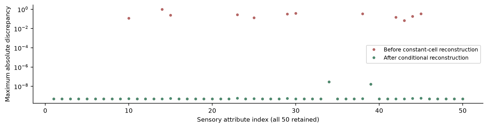
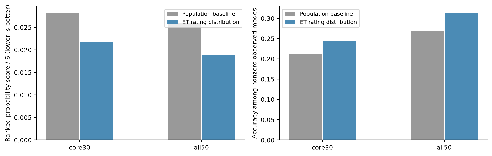
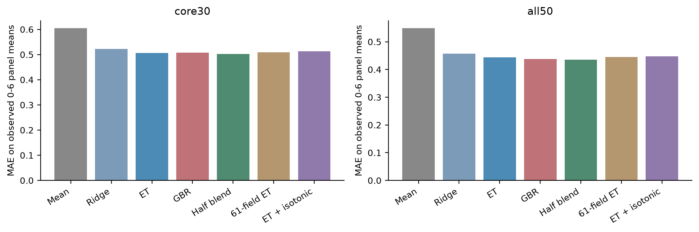
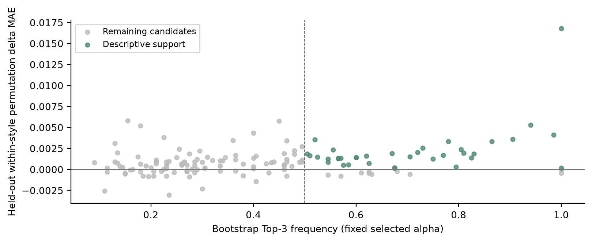
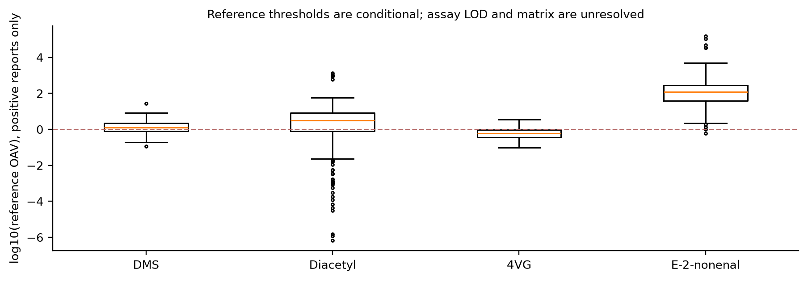
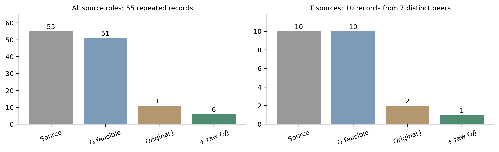

# 原始评分重建与独立约束检验下的啤酒感官预测及风格迁移

## 摘要
针对啤酒0-6感官分级、关键因素和风格生成任务，补查作者新版2197条逐人评分并重建250款酒的匿名对应，以两组分离属性核验，明确重复人员权重。由实际七级分布输出整数等级，同时预测原始面板均分。三折五次留出中，固定等权融合核心30项MAE为0.5022分，全50项为0.4356分；等级分布核心RPS为0.0218，优于总体基线，但大量0分掩盖了较弱的非零等级识别。原始端点的真实图仍未优于无图，全数据选择图惩罚为0；150条因素中36条满足描述性支持条件。核查70个化学参考字段，38列可比对完全对应，保留80处例外并完成四项阈值敏感性。冻结生成谱补齐原始尺度画像；严格复查后，真实留出来源的10条重复迁移记录仅1条获全部代理支持，浓度锚点混配无非平凡解。研究保留失败和完整复现材料，实物制备与真实品评另给执行方案，未冒充已完成。

关键词：原始感官评分；七级分布；图对照；化学尺度；条件生成；迁移诊断

## 1 问题重述与研究目标

本题要求从化合物数据给出Aroma/Flavour的0-6分级评分，建立化合物网络并给出逐维Top-3、稳定性和化学解释，最后按风格生成化合物谱及缺陷不恶化的迁移。附件与Schreurs等的啤酒研究高度吻合[1]。本研究补查作者新版公开原始评分[2]，将此前不能识别的绝对评分问题改为对实际逐人评分的直接建模。作者已有模型和加标实验不计作本队新增发现。

附件实际为250款酒、231个数值输入和50个感官标签。A_与F_前缀各15项，合计30个核心维度；其他20项也完整输出，另标明评分卡位置。这个范围选择不代表官方只要求30项；题面“约40”与实际目标数量不一致处明确列出，不补造缺失的监督列。

本文的任务交付为：真实0-6评分分布及整数等级、0-6面板均分与不确定性；基于相关图对照的逐维因素表；统计条件生成谱、原始评分尺度的预测画像和迁移诊断。统计画像、来源表记载的浓度和新批次化学/真实品评证据分别记录。

## 2 已有方法、贡献定位与假设

ExtraTrees[3]、梯度提升[4]、交叉验证组合权重[5]、图约束回归[6]和分割保形预测[7]均为已有方法。整数等级的众数和中位数决策也属于标准统计决策。本文贡献在于来源对应核查、适合该任务的验证与约束、尺度改变后的复查及失败结果记录，不主张发明新的基础算法。

假设一，比赛附件内部按beer对齐有效；新增匿名原始评分的编号不直接等于beer，而由公开补充表行序重建，并以两组分开的属性交叉核验。假设二，历史面板的均分和评分分布是本任务可用观测端点，但不等于所有消费者的唯一真实感受。假设三，插补、截尾和模型只提供统计预测，不能确认异常值或缺失机制。假设四，相关图表示共变，因素不是因果通路。假设五，历史浓度单位与条件阈值尚不足以保证新批次酿造和品评结论。

| 符号 | 定义 |
|---|---|
| X、Z | 231维附件输入及仅在训练内拟合的预处理结果 |
| s_btrj、q_bjk | 啤酒b、人员t、重复r的原始0-6评分；逐人员等权的七级分布 |
| s_bar、g | 面板均分；评分分布上的整数决策 |
| L、B | 符号图拉普拉斯及多目标回归系数 |
| G、J、T | 100款搜索训练、100款独立评价训练、50款真实留出 |
| c_s、C_A、w | 来源浓度、Tripel锚点浓度矩阵及混合份额 |

## 3 数据来源、评分重建与化学尺度核查

### 3.1 原附件、相关矩阵与评分卡

1.csv为250×234（含3列元信息），4.csv为250×53；程序按唯一beer对齐并核对风格，精度受损的beer_id不作主键。原附件未改动并保存SHA-256。2.csv与重算Spearman的平均绝对差约1.58×10^-16，与Pearson约差0.0873，因此按秩相关解释，不沿用题面中未得到数据支持的Pearson描述。

评分卡中的A/F_ester_fruity与监督表A/F_esters_fruity、4vg与X4vg作显式别名映射。乙醛的Aroma/Flavour位置没有独立监督列；12处Barnyard汇总引用AG76而标签在AG90，列为疑似源公式问题，未擅自修改，也不据此断言4.csv必然错误。空白输入的公式缓存零不作原始评分。

预处理为训练分位截尾、中位数插补与标准化，以Pipeline管理[8]；验证和测试只应用已拟合变换。原始表中负值不能一律当错误或负浓度。

公式（1）：z_ij=[clip(x_ij;a_j,b_j)-m_j]/s_j

### 3.2 新版原始评分与编号对应

2026-10-24发布的作者v4仓库新增逐人员原始评分[2]。文件含2197条记录、16名匿名人员、250款酒和50个0-6整数目标，评分无缺失；存在187条同酒同人的额外重复记录。新增文件与补充工作簿均通过作者MD5校验，原件在仓库外只读保存，公开支撑材料记录来源与校验，不重新分发原始记录。

直接把raw beer_name与附件beer同号连接会错配。重建规则是：原始编号1-250对应公开Supplementary File S4的第1-250行。该规则不是作者另行公布的映射表，因此另以按人员、各属性的样本标准差标准化后汇总的轮廓检验；按属性名字排序分成互不重叠的25项发现组与25项验证组，分别作一对一最小距离匹配，两组和行序规则对全部250款酒一致。化合物特征、预测成绩和迁移结果均未参与匹配。

38个不存在人员内零方差的属性重现公开连续标签，最大差2.8e-08。其余12项的差异只发生在部分人员从未使用该属性、导致标准差为零的位置：用奇数源编号估计每属性的固定替代常数，在偶数源编号核验，误差也低于10^-7。该常数是经验重建，并非已取得原作者完整处理程序；不把它包装成已证明的源算法。对应关系的核查使用了既有标签，只作数据身份追踪，不称为新增外部验证。

### 3.3 原始端点与人员重复的处理

对同酒同人的重复评分先平均，再在不同人员间等权平均。每款有3-14名不同人员；全部记录直接平均仅作为敏感性，二者全表平均绝对差约0.00322分。该端点是本批面板的观测均分，可直接落在0-6范围，不再依赖经验分位反演。

公式（2）：s_bar_bj=(1/|T_b|) sum_t [(1/n_bt) sum_r s_btrj]

为了满足整数分级要求，另对每人各次真实整数评分构造七级频率，先在人内等权、再在人间等权，得到每款酒每属性的观测评分分布q。没有把人员均分先四舍五入成伪个人标签，也没有把2197条评分当2197款独立啤酒。

公式（3）：q_bjk=(1/|T_b|) sum_t (1/n_bt) sum_r I(s_btrj=k)

1000次酒内人员重采样给出面板抽样敏感性，平均95%百分位区间宽约1.287分。跨日期的同人同酒首末评分平均绝对差约0.798分。这些量反映历史面板噪声，不是模型误差、一般消费者可靠度或新批次验证。人员bootstrap不纳入新批次漂移。

### 3.4 浓度变换、异常对与综合量

公开Calibrated chemical dataset提供70个数值参考字段。逐列比较恒等、非正数替换为该列最小正值的一半，以及替换后log10三种候选规则；38列在全部可比对中一致，另外32列合计保留80处数值例外。DMS和4VG的正值与零替代变换完全对应；半最小正值是可重现的数据处理规则，不能当作仪器LOD，也不能把零记录认定为真实绝对零。

在来源列具备calibrated标记且单位为mg/L、g/L、ug/L或v/v的条件下，选出61个报告浓度字段作次级模型；A.U.、无单位、pH、压力、色度及热量等不进入该浓度混合模型。这里核实的是来源声明和数值一致性，没有获得全部标准曲线、回收率或新批次测量。非正信号与缺失均保留标记，不能从元数据yes推导完整实验认证。

对五个综合量进行了13种探索性组分/仿射候选公式的交替行留出核查，没有一个达到10^-7重现精度。该失败只否定已检验候选，不能证明真实公式不存在。生成主模型继续去掉五个综合量并重训226个非聚合输入；不补造总量或用任意插补恢复物理一致性。

## 4 第一问：真实0-6分级、均分预测与缺失鲁棒性

### 4.1 整数等级的概率与决策定义

用多目标ET回归250×(50×7)的观测频率，输出非负、和为1的七级分布。树叶训练分布的加权平均使输出保持概率单纯形；这些概率尚未证明经过概率校准。众数规则用于最大化精确等级命中，中位数规则用于最小化绝对等级损失，二者均提供250×50的整数结果，平局取较低等级。

公式（4）：g_mode=argmax_k q_hat_k; g_med=min{k:sum_h<=k q_hat_h>=0.5}

模型给出0分表示预测的个人评分众数或中位数为0，不证明化合物不存在；连续面板均分则是另一种端点，不与最常见个人等级混为一谈。旧稿的经验分位等级保留为历史ASSUMPTION结果，不作为本稿的真实等级交付。

评分分布用按6个累计边界归一化的RPS和七类Brier评价。精确个人命中率按该酒实测评分频率加权；“面板众数一致率”是预测等级与实测面板众数的一致率，二者不同。另报非零面板众数的表现，避免大量0分掩盖问题。

公式（5）：RPS=(1/6nq) sum_bj sum_k=0..5 (CDF_hat_bjk-CDF_bjk)^2

| 方法（全50项） | 预期个人等级MAE | 面板众数一致率 | 非零众数一致率 | RPS |
|---|---|---|---|---|
| 训练总体分布 | 0.8514 | 77.84% | 26.92% | 0.02592 |
| ET众数规则 | 0.8248 | 79.10% | 31.33% | 0.01889 |
| ET中位数规则 | 0.7927 | 73.98% | 34.78% | 0.01889 |
| ET均分四舍五入 | 0.9319 | 40.33% | 34.93% | - |

核心30项的ET众数一致率为80.52%，总体分布基线也有79.31%；实测众数为0的比例为78.03%。非零众数准确率仅24.33%，所以不能把约80%一致率称为强的精细分级能力。RPS由0.02820降至0.02178，表明概率分布有增益；众数和中位数在各自损失下的取舍同时保留。

### 4.2 连续面板均分模型与比较

均分模型比较均值、岭回归、ET、GBR、固定等权融合、61浓度字段ET，以及训练内单调标定的旧尺度ET。ET为200棵树、叶节点最少3样本、特征比例0.8；GBR每目标100棵深度2的树、学习率0.04、叶节点最少5样本、特征比例0.7。岭α在1、10、100、1000中以内层三折核心MAE选择。单调标定仅使用外层训练酒的标准化标签与原始均分配对，外层测试标签不参与。标准方法依据见[3][4][8]。

公式（6）：B_hat=argmin_B ||Yc-ZB||^2_F+alpha||B||^2_F

外层按风格三折、五次重复，共15个划分，同酒所有人员记录聚合后作为一个样本。所有方法共享角色。报告每酒五次留出预测平均后的聚合OOF误差，单折误差另存。重复折共享样本，不能作为独立样本进行简单t检验[9]。所有模型输出限制在已知0-6范围。

公式（7）：MAE=(1/nq) sum_i sum_j |y_ij-y_hat_ij|

| 方法 | 核心30项MAE/分 | 全50项MAE/分 |
|---|---|---|
| 训练均值 | 0.60450 | 0.54879 |
| 岭回归 | 0.52270 | 0.45708 |
| ET | 0.50589 | 0.44336 |
| GBR | 0.50819 | 0.43780 |
| 固定等权融合 | 0.50222 | 0.43560 |
| 61浓度字段ET | 0.50913 | 0.44575 |
| 旧尺度ET+训练内单调标定 | 0.51332 | 0.44807 |

固定等权融合的核心MAE为0.50222，全维为0.43560；相对均值基线核心误差下降16.92%。这些数字在原始0-6面板均分尺度上计算，不能和旧标准化尺度的0.34648直接比较。原始尺度ET略优于训练内单调标定；新原始记录让直接学习真实端点成为可能，并非仅凭4.csv反演丢失信息。

### 4.3 区间、重复评分与缺失压力

另以预先固定的ET作5次150训练/50校准/50测试的分割保形示例。逐维校准残差使用第46顺序统计量，区间与已知[0,6]相交。它针对历史协议下的观测面板均分，不能解释为某一个人的评分区间或所有50项同时覆盖保证。

公式（8）：r_ij=|y_ij-f_j(x_i)|; q_j=calibration_order_statistic_46

公式（9）：C_j(x)=[f_j(x)-q_j,f_j(x)+q_j] intersect [0,6]

五次分割逐维平均覆盖90.06%，平均宽度1.7342分。每次测试50款酒，重复测试不产生新的外部样本。使用标准分割保形原理[7]，但原数据筛选、面板构成和交换性假设限制推广。

对整数分布ET在外层测试上额外模拟0%、5%、10%、20%的MCAR化合物缺失，使用同一已拟合预处理，不重估测试中位数，保留RPS、预期等级误差与等级变化率。原有真实缺失仍存在；MCAR压力不证明真实缺失随机，也不覆盖任意未知缺失机制。记录加权与人员等权的ET分别训练，敏感性结果另存，不混合两种端点成绩。

## 5 第二问：原始评分下的图对照与关键因素

### 5.1 描述图与训练内图回归

给定231节点秩相关图在|r|≥0.7时有109条边。预测图只由当前训练折重算，不能直接把含测试样本的全图用于模型。采用符号拉普拉斯和岭项，使负相关边也有明确的二次惩罚。

公式（10）：W_ij=r_ij I(|r_ij|>=tau); L=diag(sum_j|W_ij|)-W

公式（11）：min_B ||Yc-ZB||^2_F+alpha||B||^2_F+lambda tr(B^T L B)

在新原始均分上重新执行三折五次完整图实验：α∈{1,10,100,1000}、λ∈{0,1,5,20}、τ∈{0.6,0.7,0.8}，均由内层核心MAE选择。负对照为训练图节点标签打乱，每次10个图，汇总误差而非平均预测形成额外集成；使用已有图约束方法[6]。

| 图条件 | 核心30项折均MAE | 全50项折均MAE |
|---|---|---|
| 无图 | 0.536911 | 0.470061 |
| 真实图 | 0.537035 | 0.470220 |
| 打乱图 | 0.537794 | 0.471037 |

原始尺度真实图仍未改善无图结果，全数据内层选择α=1000、λ=0。此表为单折均值，与第一问五次预测平均后的OOF指标定义不同。两个评分尺度的负结果一致支持保留简单岭基线，但不证明所有网络方法在所有数据上都无用。

### 5.2 Top-3、稳定性与风格控制

按最终描述模型标准化输入系数绝对值，逐目标选择三个化合物或元素，排除pH、理化混合量与综合量。λ=0时最终模型就是普通岭，不能把Top-3归功于图惩罚。200次bootstrap每次重建预处理和图，固定全数据选定参数；留出普通与风格内置换各20次，并保留模块联合置换和删除模块重拟合诊断。

公式（12）：pi_jk=bootstrap_Top3_selection_count/bootstrap_repeats

公式（13）：Delta_jk=MAE_k(permuted_holdout)-MAE_k(original_holdout)

描述性支持条件是频率≥0.5、至少5个训练折入选、所选折平均普通和风格内置换贡献均为正；新原始端点下有36/150条满足。独立普通岭实现得到相同150条Top-3，但换一组重采样与置换种子后有37条满足条件，说明二分阈值和蒙特卡洛波动会影响支持数。它们不是独立显著性检验或因果结论，完整连续频率、贡献和弱项全部保留。

### 5.3 化学合理性与单位核验

X4vg与X4VG的关联有4VG陈化及丁香相关香气研究支持[10]；iron与metallic有口腔氧化实验支持[11]，但铁价态和金属溶液基质不能直接替代总铁在啤酒中的阈值。coriander与linalool可参照芫荽籽添加低醇啤酒研究[12]；原始评分模型中linalool的bootstrap频率未达0.5，文献合理性不覆盖统计稳定性不足。

乳酸/醋酸与酸度、乙醇与酒精感等可核查测量相容性。其余未核实候选只记为共变或预测关联，不为150条名单补造气味机理。每条保留单位、来源、系数、频率、跨折入选、风格内贡献与因果未识别状态。附录给出全部50×3结果。

缺陷参考阈值采用DMS=19 ug/L、双乙酰=0.09 mg/L、4VG=0.2 mg/L（附件中位值）；nonenal补入原始研究中的约0.1 ug/L参考值[13][14]，换算为0.0001 mg/L。全部四项均完成0.5、1、2倍敏感性。该外部值未在本批啤酒重新校准；参考OAV较高并不等于本批面板必然感知缺陷。

来源记录中的nonenal以mg/L标注，参考OAV中位数约120.4，部分测量尾部很大；这与个体阈值、基质、测量及数据处理口径共同相关。数值差异和单位问题尚未完全解决，因此这里只作条件风险筛查。Stale hops单独按感官终点处理，不给它伪造一个通用化合物阈值。

## 6 第三问：条件生成、原始评分画像与迁移边界

### 6.1 风格生成与独立评价

保留已执行的五次分层G100/J100/T50角色隔离，比较风格内重采样、局部凸组合、十维条件PCA高斯及受约束局部凸组合。每种方法、每风格、每划分生成40个样本；全部使用226个非综合字段。字段含理化描述量，不能当作226种可任意称量的纯化合物。

公式（14）：h|c~N(mu_c,w_c Sigma_c+(1-w_c)Sigma_pool)

公式（15）：x_new=u x_a+(1-u)x_b

统计合理性使用共同训练表示与带宽的MMD[15]、KS、复制比例、范围和独立J类别判断。候选先锁定再拟合J，T仅作诊断。每次角色不重叠，但同一批250款酒已用于研究开发，因此称内部角色隔离，不称新增外部验证。稀有风格留出通常很少，不能把小距离或不显著当作分布一致。

| 风格 | 方法 | 平均MMD平方 | J判断为目标风格 |
|---|---|---|---|
| Kriek | PCA_Gaussian | 0.2832 | 59.5% |
| Lambic | PCA_Gaussian | 0.2095 | 38.5% |
| Tripel | PCA_Gaussian | 0.1088 | 28.5% |
| Kriek | bootstrap | 0.2871 | 80.0% |
| Lambic | bootstrap | 0.2226 | 88.5% |
| Tripel | bootstrap | 0.1034 | 56.5% |
| Kriek | constrained_local_convex | 0.2988 | 95.0% |
| Lambic | constrained_local_convex | 0.2181 | 99.5% |
| Tripel | constrained_local_convex | 0.1158 | 69.5% |
| Kriek | local_convex | 0.3005 | 95.5% |
| Lambic | local_convex | 0.2206 | 97.5% |
| Tripel | local_convex | 0.1135 | 75.5% |

受约束生成未精确复制训练点且已检查的训练范围违反为零，但MMD未全面优于简单重采样。新原始评分到位后，在原G和J各100款酒上重新拟合原始均分与七级分布ET，给冻结的首划分480个生成谱补齐50项0-6均分及整数预测画像。画像来自模型，不是新制备酒的实测感官标签。

### 6.2 冻结统计候选的原始尺度复核

原迁移先对范围、目标支持、四项字段不增加、两个G感官代理的stale_hops不增加以及Tripel概率增益作筛选，再按改变量、目标距离和已核实阈值代理作Pareto选择。保留原半径0.25、0.5、1、2及所有失败，源字段缺失依赖插补时单独标明。

公式（16）：x_candidate,d<=x_source,d; d in {DMS,diacetyl,4VG,nonenal}

公式（17）：f_stale(candidate)<=f_stale(source)

公式（18）：||Z_candidate-Z_source||_2/sqrt(p)<=r

新增复核不改变此前候选或排序：在既定G/J角色内分别重训0-6均分ET，检查同一候选的原始尺度stale_hops是否不增加。新终点信息没有用于重新选择J支持的候选。原分类器的独立风格判断保持原定义，另报新增G和J感官条件。

| 半径1的同一批记录 | 全角色55条 | T来源10条 |
|---|---|---|
| 原G搜索可行 | 51 | 10 |
| 原J代理支持 | 11 | 2 |
| 再同时满足原始尺度G/J陈旧酒花约束 | 6 | 1 |

T来源10条记录涉及7款不同酒，新增条件后仅1条支持。它既不是10款新独立酒，也不是真实品评通过率；原先2条支持不能继续作为新版结论。原始评分到位后，独立代理分歧增加本身也是重要负结果。

### 6.3 报告浓度域的混合与线性规划

另建61报告浓度字段的次级分析，排除未标定A.U.及不能线性混合的pH/压力等描述量。以Pils来源和G中的Tripel为锚点，在浓度域按份额混合，绝不把两个log浓度作物理线性相加。四项缺陷来源缺失时不以中位数证明硬上界；零记录仍受未知检测限限制。

公式（19）：c_mix=(1-sum_a w_a)c_source+C_anchors w

先检验各单锚点0.025-0.75份额，再在失败后增加探索性的多锚点线性规划，最大化总Tripel份额，要求四项报告浓度均不增加、份额非负且总和不超过0.75。多锚点扩展是看过先导失败后的探索分析，未伪称预注册。

公式（20）：maximize sum(w); (C_A-c_source)_D w<=0; sum(w)<=0.75; w>=0

55条来源/划分记录的线性规划最大非平凡目标份额均为0，按同样规则的搜索与J复核也均无通过。该数值结论仅覆盖本组锚点、报告浓度和约束，不能证明所有酿造工艺都不可能实现迁移。它说明严格的来源保持型混配无法解决当前任务，后续需有独立去除/转化工艺、合适原料及实际测量，不能把统计剪裁浓度当作可制备配方。

原统计迁移仍提供条件候选，61字段混合用于检查其现实解释边界。两套变量、模型和可行域不同，结果不混算。所有源保留失败、未知检测限和实际品评未验证的状态继续输出。

## 7 实物验证方案、样本量与复现

真实品评未执行。已完成实际可用的方案、空白采集表、样本量敏感性和分析程序：先由实验室把候选转化为有批号的可制备小试，测定四项化合物并提供LOD/LOQ、重复、单位和回收；再对3个独立批次组织随机编码、平衡顺序的配对盲评。正式随机映射由管理员私有保存，不能把公开历史编号当现有实物批次。

示例计划为30名训练人员、3次批次配对。按人平均批次差，不能当90名独立人员。五个缺陷终点预设单侧α=0.01、非劣界0.5分，全部通过后再检验Tripel符合度是否提高；0.5分非劣不等于数学上严格差值≤0。该符合度是新定义终点，需要参考酒训练，不能冒充原评分表已有变量。

公式（21）：U_j=mean(d_j)+t_(1-alpha,n-1)sd(d_j)/sqrt(n); U_j<Delta

非中心t规划中，假设人员平均差标准差0.8分、真实差0、界0.5、α=0.01，单个终点80%功效至少需29人，30人约82.5%；标准差1.0则需43人。若界0.25、标准差0.8则需106人。这是单终点假设功效，不保证五项共同通过80%。方案不能替代真实参与者、制备或测量，空白表不含虚构观测。

当前48项测试通过，核对重复人员权重、匿名对应、非正变换、训练标定、浓度约束、未配对/空白品评拒绝及历史实现性质。结果另核查12500个均分和每规则12500个整数等级、概率和、角色、候选锁与原件。源码、配置、版本、运行环境及哈希全部保留。测试通过不等于科学假设已全部成立。

复现顺序：按来源MD5取得作者v4文件；运行run_stage4.py all；运行scripts/stage4_graph_comparison.py；运行pytest与scripts/verify_stage4.py；然后生成图表和论文。原始公开文件通过scripts/fetch_stage4_sources.py下载到仓库外；官方附件仍由参赛者自行取得，不上传签名资料或原始赛题数据。精确命令和输出索引见附录。

## 8 结论、适用范围与剩余问题

通过新版逐人原始评分与来源对应核查，本研究已完成历史面板真实0-6端点的构造、整数分级和连续预测。固定等权融合的核心MAE为0.5022分；整数分布模型相对总体基线的概率评分有改进，但非零等级识别仍弱。图约束在原始尺度也未见额外收益，完整Top-3及不稳定项如实给出。

统计生成提供风格条件谱和原始评分预测画像。更严格检查后T来源10条重复迁移记录只有1条获原有及新增代理共同支持；报告浓度的锚点混配未找到满足四项不增加的非平凡解。模型内候选、化学计量可行和真实品评是不同层面的结论，论文不把失败掩盖成成功。

仍需补充的是：来源数据中80处化学差异、未公开的检测限/校准和五个综合量精确公式，多数因素的目标特异性实验证据、稀有风格的小样本外推，以及当前新批次制备与真实品评。旧稿“没有取得原始评分”的限制已被本次公开数据核查实质推进；其余信息未因文字修订被宣称完成。队员仍需独立理解、复跑和记录实际采纳与修改。

本稿代码、分析和文字由OpenAI Codex辅助[16]；精确公开模型版本与队员真实贡献须据实际记录补充，未虚构已完成人工推导或独立验证。

## 参考文献

[1] Schreurs M, Piampongsant S, Roncoroni M, et al. Predicting and improving complex beer flavor through machine learning. Nature Communications, 15:2368, 2024. DOI:10.1038/s41467-024-46346-0.

[2] Schreurs M, et al. Data from: Predicting and improving complex beer flavor through machine learning, Version v4. Zenodo, 2026-10-24. https://zenodo.org/records/23624915，访问日期：2026-10-25. DOI:10.5281/zenodo.23624915.

[3] Geurts P, Ernst D, Wehenkel L. Extremely randomized trees. Machine Learning, 63:3-42, 2006. DOI:10.1007/s10994-006-6226-1.

[4] Friedman J H. Greedy function approximation: A gradient boosting machine. The Annals of Statistics, 29(5):1189-1232, 2001. DOI:10.1214/aos/1013203451.

[5] Breiman L. Stacked Regressions. Machine Learning, 24:49-64, 1996. DOI:10.1007/BF00117832.

[6] Li C, Li H. Variable selection and regression analysis for graph-structured covariates with an application to genomics. The Annals of Applied Statistics, 4(3):1498-1516, 2010. DOI:10.1214/10-AOAS332.

[7] Lei J, G'Sell M, Rinaldo A, et al. Distribution-Free Predictive Inference for Regression. Journal of the American Statistical Association, 113(523):1094-1111, 2018. DOI:10.1080/01621459.2017.1307116.

[8] Pedregosa F, Varoquaux G, Gramfort A, et al. Scikit-learn: Machine Learning in Python. Journal of Machine Learning Research, 12:2825-2830, 2011.

[9] Bengio Y, Grandvalet Y. No Unbiased Estimator of the Variance of K-Fold Cross-Validation. Journal of Machine Learning Research, 5:1089-1105, 2004.

[10] Vanbeneden N, Saison D, Delvaux F, Delvaux F R. Decrease of 4-vinylguaiacol during beer aging and formation of apocynol and vanillin in beer. Journal of Agricultural and Food Chemistry, 56(24):11983-11988, 2008. DOI:10.1021/jf8019453.

[11] Omur-Ozbek P, Dietrich A M, Duncan S E, Lee Y. Role of lipid oxidation, chelating agents, and antioxidants in metallic flavor development in the oral cavity. Journal of Agricultural and Food Chemistry, 60(9):2274-2280, 2012. DOI:10.1021/jf204277v.

[12] Pater A, Satora P, Januszek M. Effect of Coriander Seed Addition at Different Stages of Brewing on Selected Parameters of Low-Alcohol Wheat Beers. Molecules, 29(4):844, 2024. DOI:10.3390/molecules29040844.

[13] Meilgaard M C. Individual differences in sensory threshold for aroma chemicals added to beer. Food Quality and Preference, 4(3):153-167, 1993. DOI:10.1016/0950-3293(93)90158-3.

[14] Santos J R, Carneiro J R, Guido L F, et al. Determination of E-2-nonenal by high-performance liquid chromatography with UV detection assay for the evaluation of beer ageing. Journal of Chromatography A, 985(1-2):395-402, 2003. DOI:10.1016/S0021-9673(02)01396-1.

[15] Gretton A, Borgwardt K M, Rasch M J, et al. A Kernel Two-Sample Test. Journal of Machine Learning Research, 13:723-773, 2012.

[16] OpenAI. Codex（系统提示模型家族 GPT-6，精确可公开版本待实际界面核验），使用日期：2026-10-24 至 2026-10-25. 重要交互、采纳与未完成的人工作业见随附 AI 工具使用详情说明阶段版。

## AI工具使用与研究贡献声明

AI参与来源检索、审计、实现、实验、图表和写作。新增逐人原始评分核查改变了研究证据范围，前稿结论均按版本保留。本稿未采用新实物品评，不代填队员签名、学校或队号；关键交互、实际执行与未完成人工工作随附更新说明。

## 附录A 全部50项Top-3、结果索引与运行命令

以下为原始面板均分的最终描述模型Top-3，括号为固定全数据参数条件下的200次bootstrap入选频率。λ=0，实际为普通岭回归；不是因果概率、独立检验p值或新化学试验。

| 目标 | Top-3字段（条件入选频率） |
|---|---|
| A_malt_all | X2.acetylfuran (0.77)；ethyl.furoate (0.42)；phenethyl_alcohol (0.36) |
| A_malt_grain | gamma.nonalactone (0.30)；car.3.en.2.one (0.36)；X5.methylfurfural (0.20) |
| A_malt_bread | furfural (0.36)；ethyl.furoate (0.28)；ethyl.tiglate (0.13) |
| A_malt_cara | X2.acetylfuran (0.60)；phenethyl_alcohol (0.45)；octyl_acetate (0.31) |
| A_malt_burn | methylpyrazine (0.75)；X2.acetylfuran (0.60)；X4.methyl.1.pentanol (0.11) |
| A_hops_all | iron (0.56)；DMS (0.34)；cis.dihydro.beta.terpineol (0.20) |
| A_hops_citrus | X6.methyl.5.hepten.2.one (0.53)；terpinolene (0.19)；geraniol (0.26) |
| A_hops_tropical | DMS (0.55)；beta.phellandrene (0.26)；citronellol (0.29) |
| A_hops_noble | iron (0.36)；ethyl_octanoate (0.23)；ethyl_decanoate (0.16) |
| A_hops_woody | iron (0.27)；ethyl_2.methyl_butyrate (0.15)；X2Z.6Z.farnesol (0.23) |
| A_esters_all | acetaldehyde (0.78)；X.E..beta.ionone (0.23)；n.hexanol (0.23) |
| A_esters_ethac | acetaldehyde (0.40)；ethyl_acetate (0.21)；cis.linalool.oxide (0.17) |
| A_esters_isoaa | n.hexanol (0.40)；ambroxide (0.46)；ethyl.hexadecanoate (0.20) |
| A_esters_flower | beta.phellandrene (0.56)；X.E..alpha.ionone (0.40)；terpinolene (0.14) |
| A_esters_fruity | beta.phellandrene (0.86)；X1.10.di.epi.cubenol (0.18)；benzyl.alcohol (0.30) |
| F_malt_all | acetaldehyde (0.57)；X2.acetylfuran (0.47)；X.E..alpha.ionone (0.44) |
| F_malt_grain | X2.3.butanedione (0.49)；gamma.nonalactone (0.14)；X3.methyl.2.butenal (0.18) |
| F_malt_bread | acetaldehyde (0.26)；dehydroxy.cis.linalool.oxide (0.23)；caryophylla.4.12..8.13..dien.5.alpha.ol (0.15) |
| F_malt_cara | acetaldehyde (0.62)；ethyl.nicotinate (0.27)；isobutyl.hexanoate (0.23) |
| F_malt_burn | X2.acetylfuran (0.51)；methylpyrazine (0.57)；MeSH (0.25) |
| F_hops_all | cis.dihydro.beta.terpineol (0.70)；iron (0.70)；ethyl_isovalerate (0.40) |
| F_hops_citrus | geraniol (0.47)；citronellol (0.43)；cis.dihydro.beta.terpineol (0.41) |
| F_hops_tropical | X6.methyl.5.hepten.2.one (0.46)；DMS (0.24)；citronellol (0.27) |
| F_hops_noble | iron (0.68)；citronellol (0.23)；X14.hydroxy.alpha.humulene (0.30) |
| F_hops_woody | manool (0.43)；cis.dihydro.beta.terpineol (0.28)；n.octanol (0.15) |
| F_esters_all | acetaldehyde (0.91)；ethyl_isovalerate (0.34)；n.hexanol (0.27) |
| F_esters_ethac | acetaldehyde (0.51)；ethyl_acetate (0.47)；n.tetradecanol (0.28) |
| F_esters_isoaa | n.hexanol (0.28)；ethyl_decanoate (0.14)；acetaldehyde (0.12) |
| F_esters_flower | beta.phellandrene (0.30)；eucalyptol (0.29)；terpinolene (0.13) |
| F_esters_fruity | beta.phellandrene (0.49)；X.E..beta.ionone (0.38)；MeSH (0.17) |
| acidity | lactic_acid.mg.L. (1.00)；acetic_acid.g.L. (0.72)；X4.ethyl.guaiacol (0.12) |
| bitternes | iron (0.98)；cis.dihydro.beta.terpineol (0.63)；ethyl_octanoate (0.48) |
| sweetness | ethyl_decanoate (0.81)；iron (0.52)；ethyl_octanoate (0.28) |
| X4vg | X4VG (1.00)；delta.terpinyl.acetate (0.26)；ethyl_isovalerate (0.22) |
| diacetyl | CS2 (0.21)；X.E..beta.ionone (0.09)；octyl_acetate (0.29) |
| dms | SO2.mg.L. (0.56)；caryophylla.4.12..8.13..dien.5.alpha.ol (0.18)；neryl.formate (0.17) |
| metallic | iron (0.94)；ethyl_isovalerate (0.46)；neryl.formate (0.20) |
| stale_hops | X2.butyloctanoate (0.41)；iron (0.27)；X.E..ortho.methoxy.cinnamaldehyde (0.21) |
| t2n | germacrene.D (0.58)；isopentyl.hexanoate (0.46)；X.Z..dihydro.apofarnesal (0.18) |
| orange | X1.alpha.terpineol (0.73)；limonene (0.49)；linalool (0.38) |
| coriander | x.methyl.1.octanol (0.57)；geraniol (0.55)；linalool (0.46) |
| clove | linalool (0.81)；limonene (0.67)；eucalyptol (0.48) |
| lactic | lactic_acid.mg.L. (1.00)；acetic_acid.g.L. (0.61)；ethyl.phenylacetate (0.28) |
| acetic | lactic_acid.mg.L. (1.00)；acetic_acid.g.L. (0.62)；DES (0.23) |
| barnyard | X2.butyloctanoate (0.32)；gamma.eudesmol (0.27)；iron (0.23) |
| alcohol | acetaldehyde (0.83)；ethanol..v.v. (0.82)；X3.methyl.2.hexanol (0.47) |
| aftertaste | glycerol (0.68)；ethyl_isovalerate (0.62)；cis.dihydro.beta.terpineol (0.34) |
| body | glycerol (0.80)；acetaldehyde (0.68)；X3.methyl.2.hexanol (0.47) |
| co2 | ethyl_octanoate (0.62)；X3.methyl.2.hexanol (0.55)；ethyl_hexanoate (0.34) |
| overall | ethyl_acetate (0.49)；X2.butyloctanoate (0.34)；ethyl_hexanoate (0.14) |

| 目录 | 保存内容 |
|---|---|
| audit | 对应关系、0-6端点、人员重复、浓度例外、OAV与候选公式 |
| prediction | 15折均分预测、标定对照、区间、原始尺度普通岭敏感性 |
| ordinal | 真实七级分布、众数/中位数/均分取整、缺失压力与生成谱等级画像 |
| raw_graph/q2 | 原始端点无图/真图/打乱图、跨拟合贡献、完整Top-3 |
| transfer | 冻结候选复查、G/J原始均分画像、浓度混合、LP与候选锁 |
| protocol | 空白评分表与假设样本量；没有实际品评结果 |

命令：python scripts/fetch_stage4_sources.py；python run_stage4.py all --data-dir <官方附件目录>；python scripts/stage4_graph_comparison.py --data-dir <官方附件目录>；python -m pytest -q；python scripts/verify_stage4.py；python scripts/stage4_figures.py；python scripts/prepare_absolute_paper.py；使用scripts/build_revised_pdf.py按paper_content.json生成本稿。首次重建旧生成谱时须先运行stage3；脚本默认来源目录可由参数指定。

软件：Python 3.12及NumPy、pandas、SciPy、scikit-learn、NetworkX、Matplotlib、openpyxl；精确版本在requirements-lock.txt和各运行manifest中。PDF排版另用ReportLab、pypdf、pdfplumber和Pillow；无需声称外部依赖库源码属于本队。

## 附录B 本项目完整源程序与执行配置

以下为本项目计算、检查、图表、排版、打包、测试程序和配置。长行自动折行，行号对应原文件；第三方依赖源码不重复印入。历史程序保留以复核各阶段，最新入口为run_stage4.py。可执行原文件及逐文件哈希随支撑包提供。

PDF附录印入完整源程序，原文件列表：src/__init__.py、src/audit.py、src/common.py、src/data.py、src/q1.py、src/q2.py、src/q3.py、src/reporting.py、src/stage2.py、src/stage3_algorithms.py、src/stage3_generation.py、src/stage3_graph.py、src/stage3_prediction.py、src/stage4_audit.py、src/stage4_models.py、src/stage4_trial.py、scripts/analyze_trial.py、scripts/build_paper_pdf.py、scripts/build_revised_pdf.py、scripts/fetch_stage4_sources.py、scripts/package_reference.py、scripts/prepare_absolute_paper.py、scripts/prepare_paper.py、scripts/prepare_revised_paper.py、scripts/prepare_trial_protocol.py、scripts/render_equations.py、scripts/revised_equations.py、scripts/stage2_figures.py、scripts/stage3_figures.py、scripts/stage3_preflight.py、scripts/stage4_figures.py、scripts/stage4_graph_comparison.py、scripts/verify_absolute_paper.py、scripts/verify_reference.py、scripts/verify_revised_paper.py、scripts/verify_stage3.py、scripts/verify_stage4.py、tests/test_invariants.py、tests/test_stage2.py、tests/test_stage3_algorithms.py、tests/test_stage3_research.py、tests/test_stage4.py、run.py、run_stage2.py、run_stage3.py、run_stage4.py、config.json、config_stage2.json、config_stage3.json、config_stage3_design.json、config_stage4.json
